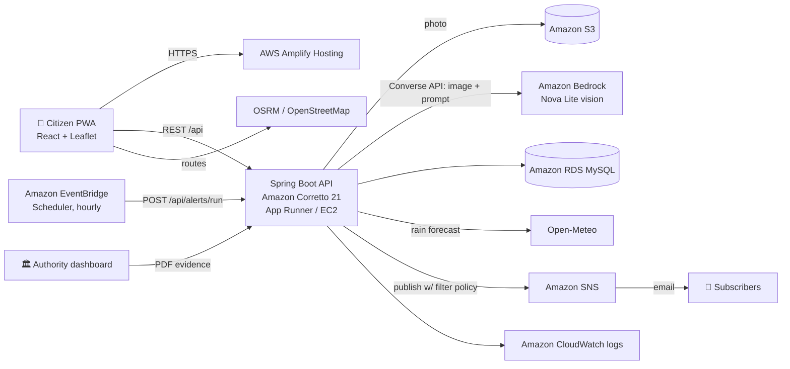

# 💧 JalMarg — safe routes through the monsoon

**WeMakeDevs × AWS Environmental Hacks · Track 02: Heat and Water · Team Growforge**

Every monsoon the same underpasses in Delhi NCR fill with water, and commuters only find out how deep it is when their scooter dies halfway through. **JalMarg** turns a single photo from someone standing at a flooded road into a live, AI-measured warning for everyone heading that way — and turns repeat flooding into evidence the city can act on.

| | |
|---|---|
| 📷 **Report in 20 s** | Photo + GPS. Pick a depth by body/vehicle reference if you like (ankle, half a bike tyre, knee…). |
| 🤖 **AI reads the depth** | Amazon Bedrock (Nova vision) estimates water depth from tyres, kerbs and legs in the frame, and returns a one-line warning in English and Hindi. |
| 🛵🚗🚶 **Who can cross** | Depth becomes plain advice: unsafe for bikes > 0.5 ft, cars > 0.8 ft, walking > 1.5 ft. |
| 🗺️ **Live map** | Reports stay live while people keep confirming them ("still flooded" / "water cleared") and expire after 6 h without confirmation. |
| 🧭 **Safe route** | Up to 3 alternative routes plus detours around the worst spot, ranked by flood risk for *your* vehicle, with a one-tap hand-off to Google Maps. |
| 🔔 **Alerts** | Hourly check of rain forecast (Open-Meteo) + live reports near your home/college; email via Amazon SNS, triggered by EventBridge. |
| 🏛️ **Authority dashboard** | Hotspots ranked by how often they flood, and a one-click **complaint PDF** addressed to MCD / Noida Authority / GNIDA / GMDA. |
| 🌐 **Built for where people are** | Installable PWA (works on any phone, no app store), Hindi/English, compressed photo uploads for weak mobile data. |

## Architecture



**AWS used:** Amazon Bedrock, Amazon Corretto (AWS open-source JDK), App Runner or EC2, S3, RDS, SNS, EventBridge Scheduler, Amplify Hosting, CloudWatch.

## Repo layout

```
backend/    Spring Boot 3 (Java 21) REST API          → docs/API.md
frontend/   React + Vite PWA (Leaflet maps, Hindi/English)
docs/       API contract, AWS deploy guide, team plan, demo video script, blog draft
infra/      IAM policy for the backend role
amplify.yml Amplify Hosting build for frontend/
```

## Run locally (no AWS account needed)

**Backend** (Java 21 + Maven; Amazon Corretto 21 recommended):
```bash
cd backend
mvn spring-boot:run
# → http://localhost:8091/api/meta   (H2 database + demo data are created automatically)
```
In Eclipse/IntelliJ: import `backend` as a Maven project and run `JalMargApplication`.

**Frontend** (Node 18+):
```bash
cd frontend
npm install
npm run dev
# → http://localhost:5173  (calls to /api are proxied to localhost:8091)
```

Without AWS settings the app runs fully: photos are stored in `backend/uploads/`, depth comes from the reporter's choice, alerts are written to the log. Turn on AWS features with environment variables — see [`docs/DEPLOY_AWS.md`](docs/DEPLOY_AWS.md).

| Variable | What it does |
|---|---|
| `AI_ENABLED=true`, `BEDROCK_MODEL_ID`, `BEDROCK_REGION` | AI depth estimation on Amazon Bedrock |
| `S3_BUCKET` | Store photos in S3 |
| `SNS_TOPIC_ARN` | Send email alerts |
| `DB_URL`, `DB_USER`, `DB_PASSWORD` | Use Amazon RDS MySQL instead of H2 |
| `CORS_ORIGINS` | Frontend URL(s), e.g. `https://main.xxxx.amplifyapp.com` |
| `ALERT_RUN_KEY` | Secret EventBridge sends to `/api/alerts/run` |

## Demo data

On first start the backend seeds 20 well-known recurring waterlogging spots in Delhi NCR (coordinates approximate) with **illustrative** report history and 6 "live" reports so the map and dashboard are not empty. Every seeded report is tagged `DEMO` and shown with a "demo data" label in the app. Refresh the live demo reports before recording:

```bash
curl -X POST -H "X-Jalmarg-Key: $ALERT_RUN_KEY" https://<backend>/api/admin/demo-refresh
```

## Team Growforge

Shivam Nishad (lead) · Vijendra Pratap Singh · Tanya Shukla · Manas Pandey — see [`docs/TEAM_TASKS.md`](docs/TEAM_TASKS.md).
