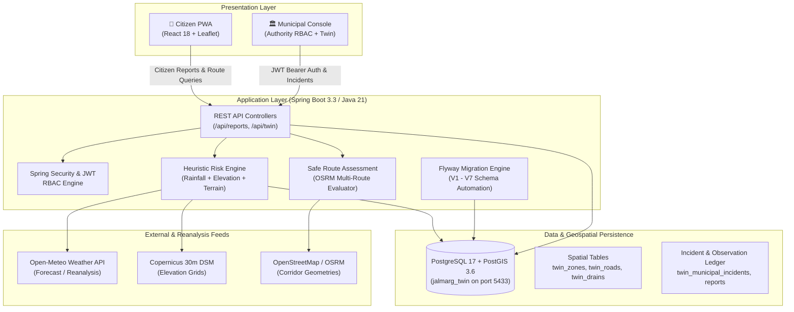
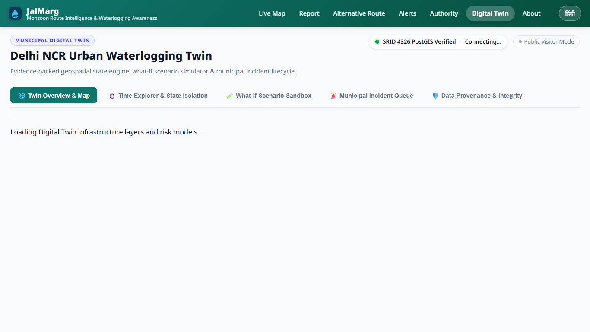

# 💧 JalMarg — Hyperlocal Monsoon Waterlogging & Safe Routing Platform

**Delhi NCR Urban Waterlogging Monitoring, Municipal Incident Management, and Geospatial Digital Twin**

[](https://spring.io/projects/spring-boot)
[](https://react.dev/)
[](https://www.postgresql.org/)
[](https://postgis.net/)
[](https://python.org/)
[](LICENSE)

---

## 1. Project Overview

During the monsoon season, low-lying arterial corridors, railway underpasses, and vulnerable intersections across Delhi National Capital Region (NCR) experience rapid and severe stormwater accumulation. Commuters often discover hazardous depths only after entering flooded corridors, leading to vehicular strandings, traffic paralysis, and emergency service delays.

**JalMarg** is an integrated, end-to-end municipal and citizen platform for hyperlocal waterlogging reporting, municipal verification, heuristic risk scoring, safe route navigation, and scenario-based urban drainage simulation.

### Key Capabilities
- **Citizen Waterlogging Reporting:** Progressive Web App (PWA) allowing citizens to submit waterlogging observations with GPS coordinates, photos, reference depth benchmarks (ankle, wheel, knee), and water clearance confirmations.
- **Municipal Verification & Incident Queue:** Role-Based Access Control (RBAC) console enabling municipal engineers and traffic police to verify ground reports, merge duplicates, dispatch pump crews, and track incident resolution lifecycles.
- **Municipal Digital Twin Sandbox:** Geospatial Digital Twin for Delhi NCR supporting 48-hour historical/forecast temporal analysis and "What-If" rainfall/obstruction simulation sandboxes that test drainage resilience without modifying live operational data.
- **Dynamic Hazard Routing:** Multi-route evaluation that ranks navigation alternatives based on road risk indices, closure flags, and vehicle clearance thresholds (two-wheeler, four-wheeler, pedestrian).
- **Meteorological & Ground Provenance Audit:** Explicit tracking of data sources, distinguishing authentic gridded rainfall reanalysis from design-criteria drainage heuristics.

---

## 2. System Architecture



---

## 3. Technology Stack

| Component | Technology | Version / Specification |
|---|---|---|
| **Backend Framework** | Java / Spring Boot | Java 21 LTS, Spring Boot 3.3.x |
| **Persistence & Spatial** | PostgreSQL + PostGIS | PostgreSQL 17.x, PostGIS 3.6.x (Hibernate Spatial) |
| **Database Migrations** | Flyway | Flyway Core 10.x (Automated V1–V7 migration pipeline) |
| **Frontend Framework** | React + Vite | React 18, Vite 5, Leaflet, HTML5 Canvas |
| **Internationalization** | Custom i18n Engine | Complete English & Hindi (हिन्दी) parity |
| **Scientific & ML Pipeline** | Python | Python 3.13, PyTorch, Pytest, Pandas, Scipy |
| **External Routing** | OSRM / OpenStreetMap | Multi-alternative waypoint and risk scoring |

---

## 4. Digital Twin Interface

The JalMarg Digital Twin provides municipal decision-makers with a 5-tab geospatial operations console:



1. **Twin Overview & Map:** Live telemetry status, 10 monitored municipal zones, 12 arterial corridors, 8 drainage outfalls, and 9 data feeds.
2. **Time Explorer & State Isolation:** 48-hour temporal slider allowing scenario replay without mutating live operational database state.
3. **What-If Scenario Sandbox:** Cloudburst and obstruction simulation estimating risk deltas and recommended preventive pump dispatches.
4. **Municipal Incident Queue:** Secure incident lifecycle management (`NEW` → `ASSIGNED` → `IN_PROGRESS` → `RESOLVED`) with full audit logging.
5. **Data Provenance & Integrity:** Transparent matrix of authentic vs simulated telemetry sources.

---

## 5. Scientific Grounding & Operational Limitations

To maintain strict scientific and engineering integrity, JalMarg explicitly documents its design principles and boundaries:

> [!IMPORTANT]
> **Heuristic Risk vs Physical Hydraulics:** Waterlogging risk scores (0–100) are generated using heuristic multi-factor weighted indices combining recent rainfall intensity, topographic depression index, road drainage vulnerability, and citizen reports. JalMarg does **not** simulate 2D hydrodynamic Saint-Venant shallow water equations.
>
> **No IoT Sensor Claims:** JalMarg does **not** claim connection to live physical depth sensors or ultrasonic culvert telemetry. Drainage capacity figures are design-criteria heuristics based on municipal stormwater drainage guidelines (PWD Delhi).
>
> **Predictive ML Readiness Gating:** Supervised predictive machine learning for automated depth inference remains **gated** (`PARTIALLY_READY` / `BLOCKED`) until sufficient independently verified ground-truth positive/negative sensor observations are collected. Autonomous machine-learning depth predictions are disabled in production.

---

## 6. Local Installation & Setup

### Prerequisites
- **JDK 21** (e.g. Eclipse Temurin or Amazon Corretto 21)
- **Apache Maven 3.9+**
- **Node.js 18+** & npm 9+
- **PostgreSQL 17+** with **PostGIS 3.6+** extension
- **Python 3.13+** (Optional, for scientific audit suite)

### Step 1: Database Initialization (Zero-Dump Setup)
No proprietary database dump or backup file is required. The schema is automatically created via Flyway migrations.

1. Connect to your PostgreSQL instance using `psql`:
   ```sql
   CREATE DATABASE jalmarg_twin;
   \c jalmarg_twin
   CREATE EXTENSION IF NOT EXISTS postgis;
   ```
2. By default, JalMarg's PostGIS profile expects PostgreSQL on port `5433` (or configure your port via `DB_URL`).

### Step 2: Environment Configuration
Copy the root configuration template:
```bash
cp .env.example .env
```
Key configuration parameters:
```ini
SPRING_PROFILES_ACTIVE=postgis
DB_URL=jdbc:postgresql://127.0.0.1:5433/jalmarg_twin
DB_USER=postgres
DB_PASSWORD=your_secure_password
PORT=8080
CORS_ORIGINS=http://localhost:5173,http://127.0.0.1:5173
```

### Step 3: Launch Backend
```bash
cd backend
mvn spring-boot:run -Dspring-boot.run.profiles=postgis
```
*On initial startup, Flyway automatically applies migrations `V1` through `V7` to construct tables, spatial indexes, and initial reference zones.*

Backend health endpoint: `http://localhost:8080/api/meta`

### Step 4: Launch Frontend
In a separate terminal:
```bash
cd frontend
npm install
npm run dev
```
Open your browser to: `http://localhost:5173`

---

## 7. Automated Test Verification

JalMarg maintains comprehensive test suites across backend, frontend, and scientific subsystems:

```bash
# 1. Spring Boot Backend Test Suite (123 Tests)
cd backend
mvn test

# 2. Frontend Unit & Integration Tests (51 Tests)
cd frontend
npm test

# 3. Scientific ML Regression Suite (44 Tests)
cd ml
pytest -v
```

---

## 8. Database Schema & Flyway Migrations

The database architecture is versioned and managed through Flyway in `backend/src/main/resources/db/migration/postgis/`:

| Version | Script Name | Scope |
|---|---|---|
| `V1` | `V1__municipal_digital_twin_postgis.sql` | Core Digital Twin schema, zones, roads, drains, scenarios, incident queue, audit log |
| `V2` | `V2__verified_delhi_ncr_geospatial_data.sql` | Authentic Delhi NCR administrative zones, arterial corridors, drainage outfalls |
| `V3` | `V3__municipal_auth_and_report_verification.sql` | Municipal authentication, RBAC, observation traceability, verification status |
| `V4` | `V4__ml_data_foundation.sql` | ML feature store foundation, environmental observations |
| `V5` | `V5__cv_image_inference_enrichment.sql` | Computer vision image inference enrichment schema |
| `V6` | `V6__ground_truth_and_ml_reliability.sql` | Ground truth observations, sensor integrity, dual-threshold abstention policies |
| `V7` | `V7__rainfall_coverage_and_inspection_workflows.sql` | Historical rainfall reanalysis coverage, dry-road negative inspections, municipal supervisor reviews |

---

## 9. Data Source Attribution & Licensing

| Source / Provider | Data Type | Usage & Attribution |
|---|---|---|
| **ECMWF / Copernicus** | ERA5-Land Hourly Reanalysis (0.1°) | Open access via Copernicus Climate Change Service Licence. |
| **Open-Meteo** | Weather API & Gridded Forecast | Open-Meteo API terms (Attribution to ECMWF/DWD/NOAA). |
| **Copernicus DEM** | 30m Global Digital Surface Model | Open access under Copernicus WorldCover / GLO-30 terms. |
| **OpenStreetMap** | Street & Highway Vector Geometries | © OpenStreetMap contributors, licensed under ODbL. |
| **Delhi PWD / MCD** | Drainage Guidelines (2021) | Public engineering design criteria for stormwater outfalls. |

---

## 10. License

This project is licensed under the Apache License 2.0. See [LICENSE](LICENSE) for details.
