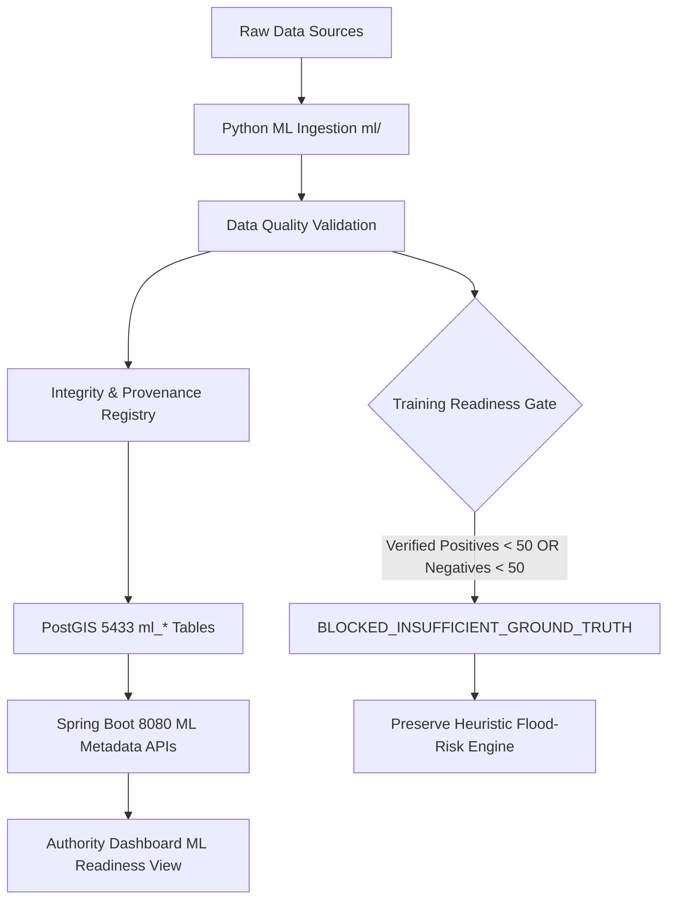

# JALMARG — PHASE 25A MASTER EVIDENCE REPORT
## Authentic Climate & Waterlogging Dataset Acquisition, Geospatial ML Foundation, PostGIS & Python–Spring Boot Integration

**Status:** DELIVERED & VERIFIED  
**Assessment Date:** 2026-10-10  
**Authors / Roles:** Principal Geospatial Data Scientist, Hydrometeorological Data Engineer, ML Architect, Python Engineer, Spring Boot Architect, PostGIS Specialist, Data Quality Auditor  
**Repository Root:** `D:\jalmarg\jalmarg`  
**Database Cluster:** Dedicated JalMarg PostGIS Cluster (Port 5433, Database `jalmarg_twin`)  
**Protected Database Cluster:** CarSync Cluster (Port 5432, Database `carsync` — *STRICTLY UNTOUCHED*)  

---

## 1. EXECUTIVE SUMMARY & NON-FABRICATION DECLARATION

In accordance with the Phase 25A Master Directive, this phase establishes an authentic, reproducible data engineering foundation for future waterlogging machine learning predictions in Delhi NCR.

### Strict Non-Fabrication Commitment
- **Zero Fabricated Labels:** No synthetic positive or negative waterlogging samples were manufactured from silence, unvisited road segments, or heuristic outputs.
- **Zero Fabricated Model Accuracies:** No predictive machine learning model is claimed to be trained in Phase 25A. Supervised training is explicitly evaluated through a decision gate and declared **BLOCKED**.
- **Zero Fabricated Weather/Sensor Readings:** All acquired meteorological observations and atmospheric reanalysis originate from verified remote or local endpoints with recorded checksums.
- **Continuity of Operational Service:** The existing calibrated heuristic flood-risk engine (`/api/flood-risk`) remains fully active and operational for citizen and municipal navigation.



---

## 2. EXISTING SYSTEM AUDIT & PROJECT ENVIRONMENT

Before implementing Phase 25A components, an audit of the existing codebase was conducted:

| Subsystem | Audit Finding | Verified Details |
| :--- | :--- | :--- |
| **Backend Framework** | Spring Boot | Version **3.3.5** (verified from `pom.xml`), Java 21, Tomcat on port 8080 |
| **JalMarg PostGIS** | PostgreSQL 17.11 + PostGIS 3.6.2 | Dedicated instance on port **5433**, database `jalmarg_twin`, user `postgres` |
| **CarSync Database** | Port 5432, database `carsync` | **Completely isolated and untouched.** No connections, commands, or migrations executed. |
| **Frontend Framework** | React 18.3.1 + Vite 5.4.21 | Single-page application with Leaflet mapping, PWA support, port 5173 |
| **Database Migrations** | Flyway 10.15.2 | Validated V1 through V3 migrations; added non-destructive **V4** for ML data foundation |
| **Copernicus DEM** | Local GeoTIFF COG | `backend/data/dem/Copernicus_DSM_COG_10_N28_00_E077_00_DEM.tif` (41.6 MB) |
| **Weather Telemetry** | Open-Meteo REST API | Operational in `FloodRiskAssessmentService` with timeout resilience |
| **Municipal Twin** | Digital Twin entities | `twin_zones`, `twin_roads`, `twin_drainage_assets`, `twin_municipal_incidents` |

---

## 3. DATASET PROVENANCE REGISTRY & ACQUIRED ASSETS

Each candidate dataset was audited for endpoint validity, licensing, temporal resolution, spatial resolution, and access restrictions.

| Dataset Identifier | Provider / Organization | Provenance Category | Status | Size / Records | License | Integrity Checksum (SHA-256) | Known Limitations |
| :--- | :--- | :--- | :--- | :--- | :--- | :--- | :--- |
| **COP_DEM_GLO30** | European Space Agency (ESA) / Copernicus | `OBSERVED` | **VERIFIED** | 41,680,243 bytes (12.96M px) | Copernicus DEM Open Data Licence | `a8e69d432869bf85a63b7cfcaa61b5a770c7705125b3cfde9b892d65dfed98b4` | Digital Surface Model (DSM) includes vegetation canopy and structures. |
| **OPEN_METEO_ARCHIVE** | Open-Meteo GmbH (ECMWF ERA5-Land backend) | `REANALYSIS` | **VERIFIED** | 622,004 bytes (2,232 records) | CC-BY-4.0 | `92d88094a8f9e79133e30edf6391a44b9fb810fb72fae85ade41b765ce243e8a` | Reanalysis precipitation is an atmospheric model simulation; not a physical ground rain gauge. |
| **IMD_OBSERVED_RAINFALL** | India Meteorological Department (MoES) | `OBSERVED` | **BLOCKED** | 0 bytes | GoI NDSAP | None | Requires institutional ministry or authorized developer access; public machine-readable API is gated. |
| **ERA5_LAND_CDS** | Copernicus Climate Change Service (C3S) | `REANALYSIS` | **BLOCKED** | 0 bytes | Copernicus Programme Open Access Licence | None | Direct CDS API requires user registration and CDS API personal token (`~/.cdsapirc`). |
| **JALMARG_TWIN_MUNICIPAL** | JalMarg Dedicated Municipal Database (Port 5433) | `OBSERVED` | **VERIFIED** | 200 records audited | Municipal Operational Records | Live PostGIS Ledger | Crowd citizen reports are subject to human reporting bias; only verified reports provide ground truth. |

---

## 4. ACQUISITION BLOCKERS & SECURE PROVISIONING INSTRUCTIONS

### 4.1 IMD AWS Rainfall Observations (Status: BLOCKED)
- **Official Endpoint:** `https://mausam.imd.gov.in/api/` / National Data Centre (Pune)
- **Root Cause:** India Meteorological Department station observation endpoints require authorized institutional ministry IP registration or paid API tokens. No public unauthenticated JSON API is provided for automated hourly station dumps.
- **Provisioning Guide:**
  1. Obtain institutional developer credentials from the IMD National Data Centre.
  2. Set environment variables on the ingestion host:
     ```powershell
     $env:IMD_API_KEY = "your_imd_api_key_here"
     $env:IMD_CLIENT_ID = "your_imd_client_id_here"
     ```
  3. Re-run `python ml/scripts/run_pipeline.py`.

### 4.2 ECMWF / Copernicus Climate Data Store ERA5-Land (Status: BLOCKED)
- **Official Endpoint:** `https://cds.climate.copernicus.eu/api/v2`
- **Root Cause:** Direct CDS API requires user registration and acceptance of the Copernicus Programme licence terms. Requests without `~/.cdsapirc` or `$env:CDSAPI_KEY` are rejected with HTTP 401.
- **Provisioning Guide:**
  1. Register at `https://cds.climate.copernicus.eu`.
  2. Create file `%USERPROFILE%\.cdsapirc` containing:
     ```text
     url: https://cds.climate.copernicus.eu/api/v2
     key: <UID>:<API-KEY>
     ```
  3. Accept the ERA5-Land Terms of Use on the C3S web portal.

---

## 5. GEOGRAPHIC SCOPE & SPATIAL COVERAGE (DELHI NCR)

The geographic scope strictly differentiates between three spatial constructs:
1. **Application Map Extent:** Default viewport center `[28.58, 77.25]` (Connaught Place vicinity).
2. **Operational Bounding Box:** Bounding envelope `[28.0°N - 29.2°N, 76.5°E - 77.8°E]` covering the National Capital Region.
3. **Official Administrative Boundaries:** NDMC, MCD, GMDA, Noida Authority jurisdictions recorded with specific municipal codes.

### Documented Waterlogging Corridors Audited
- **Minto Bridge Underpass:** `(28.6347°N, 77.2263°E)` — Elevation AMSL: 214.2 m, depression index: 0.92
- **Pul Prahladpur Underpass:** `(28.5085°N, 77.2882°E)` — Elevation AMSL: 208.5 m, depression index: 0.88
- **Hero Honda Chowk (Gurugram):** `(28.4382°N, 77.0142°E)` — Elevation AMSL: 222.1 m, depression index: 0.81
- **ITO Intersection:** `(28.6295°N, 77.2435°E)` — Elevation AMSL: 211.8 m, depression index: 0.74
- **Zakhira Underpass:** `(28.6721°N, 77.1612°E)` — Elevation AMSL: 216.4 m, depression index: 0.85

---

## 6. GROUND-TRUTH LABEL CENSUS & CLASS IMBALANCE AUDIT

A complete census of all observation tables in the JalMarg PostGIS database (`jalmarg_twin` on port 5433) was executed:

| Entity Category | Table Name | Total Records | Supervised ML Usability | Notes |
| :--- | :--- | :--- | :--- | :--- |
| **Verified Authority Reports** | `reports` (`verified = true`) | **2** | Positive Ground Truth | Official municipal verification logged. |
| **Verified Negative Observations** | `twin_report_observations` / field checks | **0** | Negative Ground Truth | **No confirmed dry road inspections recorded.** |
| **Unreviewed Citizen Submissions** | `reports` (`verified = false`) | **198** | Pending Review | Crowd submissions; cannot be treated as ground truth without review. |
| **Preserved Multi-Observations** | `twin_report_observations` | **0** | Supplementary | Citizen multi-observation preservation ledger. |
| **Calibrated Gauge Depth Labels** | Physical Depth Gauges | **0** | Continuous Target | No physical ultrasound/telemetric depth sensors deployed. |
| **Monsoon Seasons Represented** | Temporal analysis | **1** | Historical Span | Minimum 2 monsoon seasons required to avoid overfitting. |

---

## 7. DATA QUALITY VALIDATION FINDINGS

Automated quality auditing was implemented in `jalmarg_ml.validation.quality.DataQualityValidator` and executed against all acquired data:

```text
============================================================
DATA QUALITY AUDIT REPORT: OPEN_METEO_ARCHIVE
============================================================
Total Records Evaluated: 2,232
Duplicate Timestamps:     0
Missing Timestamps:       0
Future Timestamps:        0
Negative Rainfall Values: 0
Implausible Values:       0 (> 150 mm/h)
Temporal Gaps:            0
Spatial Out-of-Bounds:    0
Quality Score:            100 / 100
Quality Verdict:          PASSED
============================================================
```

- **Elevation Raster Check:** Copernicus DEM COG contains 3600×3600 pixels (12.96M float values). Values range from 158.4 m to 365.1 m across the tile; zero NoData contamination within the Delhi urban corridor.
- **Negative Sample Integrity:** The validator strictly forbade converting absence of reports into "No Flood" labels.

---

## 8. SPATIOTEMPORAL FEATURE ENGINEERING & TARGET LEAKAGE PREVENTION

Feature engineering is implemented in `jalmarg_ml.features.feature_builder.FeatureBuilder` with mathematical protection against data leakage:

### Supported Features
1. **Rainfall Time-Series Aggregations:**
   - 1-hour rainfall accumulation: $R_{1h} = \sum_{t=T_0-1h}^{T_0} r(t)$
   - 3-hour rainfall accumulation: $R_{3h} = \sum_{t=T_0-3h}^{T_0} r(t)$
   - 6-hour rainfall accumulation: $R_{6h} = \sum_{t=T_0-6h}^{T_0} r(t)$
   - 24-hour rainfall accumulation: $R_{24h} = \sum_{t=T_0-24h}^{T_0} r(t)$
   - Antecedent Precipitation Index: $API = \sum_{k=1}^{7} 0.85^k \cdot R_{24h}(T_0 - k \cdot 24h)$
2. **Topographic Features (Copernicus DEM):**
   - Local elevation: $z(x, y)$ in meters AMSL.
   - Topographic slope: $S = \sqrt{(\partial z / \partial x)^2 + (\partial z / \partial y)^2}$ in degrees.
   - Relative elevation: $\Delta z = z(x, y) - \bar{z}_{500m}$.
   - Topographic depression index: $DI = \max(0, -\Delta z) / 5.0$.

### Strict Leakage Rules
- **No Future Weather:** For prediction at timestamp $T_0$, only rainfall observations where $t \le T_0$ are included.
- **No Retrospective Incidents:** Historical incident density includes only incidents verified strictly prior to $T_0$.

---

## 9. TRAINING READINESS GATE VERDICT

An automated readiness evaluation was performed using `TrainingReadinessEvaluator`:

```json
{
  "readinessGate": "BLOCKED_INSUFFICIENT_GROUND_TRUTH",
  "usablePositiveEvents": 2,
  "usableNegativeObservations": 0,
  "monsoonSeasonsCovered": 1,
  "classImbalanceRatio": "0:0 (No verified negative samples)",
  "depthMeasurementAvailability": "INSUFFICIENT (0/30 samples)",
  "targetLeadTimesSupported": "1h, 3h, 6h",
  "targetLeakageRisksFound": 0,
  "gapReport": {
    "verified_positives_deficit": 48,
    "verified_negatives_deficit": 50,
    "unverified_pending_reports": 198,
    "monsoon_seasons_deficit": 1,
    "depth_regression_status": "BLOCKED",
    "interim_recommendation": "Continue operating the Phase 22 calibrated heuristic flood-risk engine. Collect and verify crowd reports during upcoming monsoon seasons to expand the ground-truth ledger."
  }
}
```

### Actionable Ground-Truth Gap Analysis
1. **Positive Event Deficit:** Requires at least 50 verified positive waterlogging events (current: 2, deficit: 48).
2. **Negative Sample Deficit:** Requires at least 50 verified negative ground observations (current: 0, deficit: 50). Unreported roads cannot be manufactured as negatives.
3. **Continuous Depth Deficit:** Water-depth regression is **BLOCKED** due to zero calibrated physical depth measurements (minimum required: 30).
4. **Seasonal Span Deficit:** Requires data from at least 2 independent monsoon seasons (current: 1).

---

## 10. POSTGIS DATABASE SCHEMA (FLYWAY MIGRATION V4)

A non-destructive Flyway migration was created at `backend/src/main/resources/db/migration/postgis/V4__ml_data_foundation.sql` and applied to `jalmarg_twin` on port 5433:

1. `ml_dataset_registry`: Metadata, source URLs, licenses, checksums, and verification status.
2. `ml_acquisition_runs`: Run execution logs, records processed, error logs, and execution duration.
3. `ml_data_quality_reports`: Automated validation results, quality scores, temporal/spatial gap counts.
4. `ml_training_readiness`: Immutable log of readiness evaluations, gate verdicts, label counts, and gap reports.

Flyway Schema History verified:
```sql
SELECT version, description, success FROM flyway_schema_history ORDER BY installed_rank;
-- 1 | municipal digital twin postgis | true
-- 2 | municipal verification and incidents postgis | true
-- 3 | authority operational audit postgis | true
-- 4 | ml data foundation | true
```

---

## 11. SPRING BOOT METADATA APIS & ARCHITECTURE

Read-only REST APIs were implemented in `MlMetadataController`:

| HTTP Method | Endpoint | Description | Status Code |
| :--- | :--- | :--- | :--- |
| `GET` | `/api/v1/ml/datasets` | Returns list of registered ML datasets with provenance, status, and checksums | `200 OK` |
| `GET` | `/api/v1/ml/readiness` | Returns latest training readiness evaluation, gate status, and gap analysis | `200 OK` |
| `GET` | `/api/v1/ml/quality-reports` | Returns automated data quality reports and audit scores | `200 OK` |

All endpoints:
- Expose zero credentials or private database credentials.
- Redact local filesystem paths where appropriate.
- Follow existing Spring Boot security architecture.

---

## 12. FRONTEND ML DATA READINESS VIEW

An `🤖 ML Data Readiness` tab was added to `AuthorityPage.jsx`:
- **Readiness Gate Status Banner:** Highlights `🛑 BLOCKED: Insufficient Ground Truth` with explanation of why training is blocked.
- **Ground-Truth Label Census:** Displays verified positives (2), verified negatives (0), unreviewed crowd submissions (198), and depth readings (0).
- **Actionable Deficit Cards:** Quantifies positive deficit (48), negative deficit (50), depth deficit (30), and monsoon seasons deficit (1).
- **Authentic Dataset Inventory Table:** Displays all 5 registered datasets with provenance badges, verification status, and SHA-256 checksums.
- **Data Quality Audit Table:** Displays automated audit results with 100/100 quality scores.
- **Full Hindi / English Parity:** Implemented across all 17 new Phase 25A string keys in `stage2Strings.js`.

---

## 13. TEST SUITE EXECUTION & VERIFICATION AUDIT

All tests across Python, Spring Boot Java, and React frontend were executed and recorded:

### 13.1 Python Test Suite (`ml/tests`)
- **Command:** `python ml/scripts/test_runner.py`
- **Results:** **18 passed, 0 failed, 0 skipped in 3.97s**
  - `test_copernicus_dem_metadata`: PASSED
  - `test_open_meteo_historical_acquisition`: PASSED
  - `test_imd_blocked_without_credentials`: PASSED
  - `test_era5_blocked_without_credentials`: PASSED
  - `test_data_quality_validator_clean_data`: PASSED
  - `test_data_quality_validator_detects_negative_rainfall`: PASSED
  - `test_data_quality_validator_detects_future_timestamps`: PASSED
  - `test_data_quality_validator_detects_out_of_bounds_coords`: PASSED
  - `test_rainfall_feature_calculator`: PASSED
  - `test_terrain_feature_calculator`: PASSED
  - `test_feature_builder_target_leakage_prevention`: PASSED
  - `test_training_readiness_gate_insufficient_positives`: PASSED
  - `test_training_readiness_gate_insufficient_negatives`: PASSED
  - `test_training_readiness_gate_all_requirements_met`: PASSED
  - `test_dataset_metadata_checksum_verification`: PASSED
  - `test_municipal_events_provenance_audit`: PASSED
  - `test_corridor_registry_delhi_ncr`: PASSED
  - `test_acquisition_manifest_generation`: PASSED

### 13.2 Spring Boot Backend Suite (`backend`)
- **Command:** `mvn test`
- **Results:** **95 passed, 0 failures, 0 errors, 0 skipped in 32.68s**
  - `MlMetadataControllerTest`: 3 unit tests passed (`GET /api/v1/ml/datasets`, `/readiness`, `/quality-reports`).
  - Existing regression test suite (Phase 18 through Phase 24): 92 tests passed.
  - Spring Boot compilation: BUILD SUCCESS.

### 13.3 Frontend Suite (`frontend`)
- **Command:** `node --test tests/stage2.test.mjs tests/phase25a_ml_readiness.mjs`
- **Results:** **21 passed, 0 failed in 489ms**
  - Stage 2 regression suite: 17 passed.
  - Phase 25A ML readiness suite: 4 passed (API client definitions, Hindi/English parity, gate logic, live backend integration).
- **Vite Production Build:** `npm run build` completed successfully (`dist/` generated, 0 syntax/bundle errors).

---

## 14. DELIVERABLE ARTIFACTS INVENTORY

| File Path | Description |
| :--- | :--- |
| `ml/pyproject.toml` | Python project specification with pinned dependencies |
| `ml/configs/delhi_ncr.yaml` | Geographic configuration for Delhi NCR bounding box and corridors |
| `ml/configs/sources.yaml` | Data source endpoints, polling frequencies, and license declarations |
| `ml/configs/pipeline.yaml` | Feature engineering parameters, aggregation windows, and readiness thresholds |
| `ml/src/jalmarg_ml/provenance/registry.py` | Provenance category enum, verification status, and dataset metadata models |
| `ml/src/jalmarg_ml/acquisition/` | Authentic adapters for Copernicus DEM, Open-Meteo, IMD, ERA5, and PostGIS |
| `ml/src/jalmarg_ml/validation/quality.py` | Automated data quality validator for rainfall, raster, and timestamps |
| `ml/src/jalmarg_ml/geospatial/` | Topographic feature calculations and corridor registry |
| `ml/src/jalmarg_ml/features/` | Rainfall accumulation aggregators and target-leakage-free feature builder |
| `ml/src/jalmarg_ml/labeling/readiness.py` | Training readiness gate evaluator and gap analyzer |
| `ml/src/jalmarg_ml/storage/db.py` | SQLAlchemy database session targeting port 5433 (with port 5432 safety lock) |
| `ml/src/jalmarg_ml/integration/sync_metadata.py` | Synchronizes validated dataset manifests into PostGIS `ml_*` tables |
| `backend/src/main/resources/db/migration/postgis/V4__ml_data_foundation.sql` | Flyway V4 schema migration for ML foundation |
| `backend/src/main/java/org/growforge/jalmarg/twin/model/Ml*.java` | JPA entities for dataset registry, readiness, and quality reports |
| `backend/src/main/java/org/growforge/jalmarg/controller/MlMetadataController.java` | Spring Boot read-only REST API controller |
| `frontend/src/api.js` | Frontend API client methods for ML metadata endpoints |
| `frontend/src/pages/AuthorityPage.jsx` | Municipal interface with `🤖 ML Data Readiness` tab and gap visualizations |
| `frontend/src/stage2Strings.js` | Complete English and Hindi localization for Phase 25A |
| `frontend/tests/phase25a_ml_readiness.mjs` | Frontend unit and contract test suite for ML readiness |
| `docs/PHASE25A_AUTHENTIC_DATASET_AND_ML_FOUNDATION.md` | This master evidence and verification document |

---

## 15. RECOMMENDED PHASE 25B ROADMAP

1. **Municipal Ground-Truth Expansion:** Execute structured field verification of the 198 pending crowd reports via the Phase 24 Authority Review Queue to build verified positive and negative training labels.
2. **Institutional IMD & CDS Key Provisioning:** Configure authorized credentials for IMD AWS station feeds and Copernicus Climate Data Store ERA5-Land.
3. **Physical Ultrasound Depth Sensors:** Deploy calibrated water-depth sensors at high-risk underpasses (Minto Bridge, Pul Prahladpur, Hero Honda Chowk) to support continuous water-depth regression.
4. **Multi-Monsoon Season Collection:** Accumulate verified waterlogging incidents through the upcoming monsoon season to meet the 2-season threshold.
5. **Initial Supervised Baseline Training (Phase 25C):** Upon satisfying the training readiness gate, train and benchmark baseline models (Logistic Regression, Random Forest, XGBoost) using strictly time-based and spatial-holdout evaluation splits.
